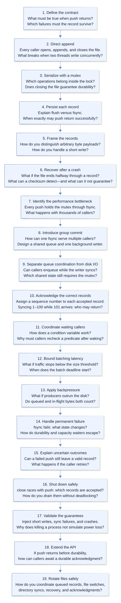

# Thread-safe durable event writer

Interview preparation for [the PracHub question](https://prachub.com/interview-questions/thread-safe-durable-event-writer-shared-by-thousands-of-threads).

- [One-page cheat sheet](cheatsheet.md)
- [Interview flow diagram (SVG)](interview-flow.svg)
- [Interview flow diagram (PNG)](interview-flow.png)
- [Editable Mermaid source](interview-flow.mmd)
- [Commented Python implementation](data_writer.py)



## Run the implementation

Python 3 on Linux/POSIX; standard library only:

```python
from data_writer import DataWriter

with DataWriter("events.bin") as writer:
    writer.push(b"hello")
    writer.push(b"\x00\xff opaque bytes")
```

The implementation is the immediate-drain version discussed in the interview: it groups records already queued and does not deliberately wait to fill a batch. Thus low traffic is synced immediately. The diagram and cheat sheet also describe an optional size/deadline policy for collecting larger groups.

## Assumptions and limits

- One instance exclusively owns the file; no concurrent external writers.
- Storage honors `fsync()`. Permanent disk loss is outside scope.
- Recovery truncates incomplete tails and reports checksum/length corruption rather than silently discarding complete frames.
- Failed or interrupted pushes may have persisted; automatic retries can duplicate records.
- The byte limit bounds accepted outstanding frames, not all process memory. Blocked callers retain their inputs and frames; combining a batch also temporarily copies its bytes.
- Use `close()` or the context manager: the background worker is non-daemon.
- Local checks verify logic and fault handling, not real power-loss guarantees.
